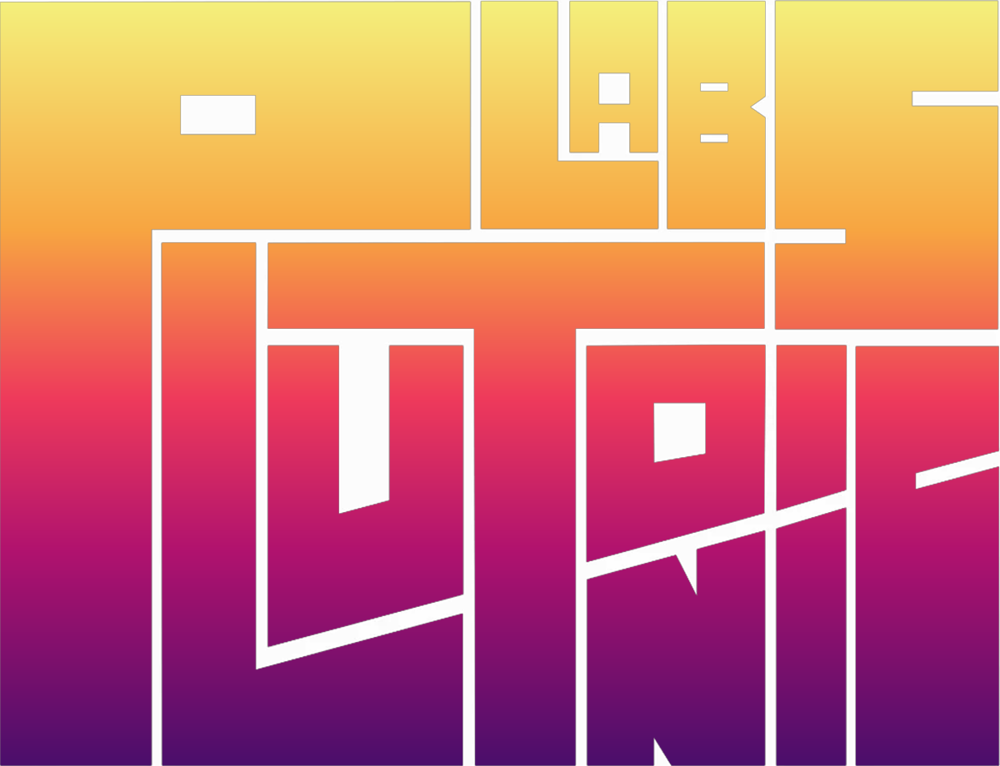

  

<h1 align="center">BeaTonic</h1>

<em>Montaggio a tempo di musica in DaVinci Resolve: le shot cadono sui beat.</em>

  
  
  
  

---

## Cos'è

**BeaTonic** crea un **montaggio ritmato a tempo di musica**. Gli dai delle clip
video e una canzone: lui analizza i **cambi di scena** nelle clip (le spezza in
singole "shot") e i **beat** del brano, poi monta le shot tagliandole **sui beat**.
Il risultato è una timeline già a ritmo — il tipo di stacco-su-stacco che a mano
richiede ore.

Il taglio segue l'energia della canzone: dove il brano spinge, gli stacchi si
infittiscono; dove si calma o sfuma, rallentano. Scegli lo **stile**
(veloce / medio / lento / **dinamico**, che segue da solo i sali-e-scendi del
pezzo), la **durata** in secondi e il **formato** (orizzontale 16:9 o verticale 9:16
per i social).

---

## Due temi

Col pulsante in alto a destra passi tra **Scuro — Plutonic Studio** (viola) e
**Chiaro — Plutonic Labs** (paper + gradiente tramonto). La scelta è ricordata e
condivisa con PlutoniCut.

---

## Requisiti

- **DaVinci Resolve Studio** (lo scripting non è disponibile nella versione gratuita).
- **ffmpeg** — rilevato in automatico se è in `D:\ffmpeg\bin` o `C:\ffmpeg\bin`;
  altrimenti imposta la variabile d'ambiente `FFMPEG` col percorso di `ffmpeg.exe`.
  → Scarica da **https://www.gyan.dev/ffmpeg/builds/** (build "release essentials").
- **Nessuna** dipendenza Python: usa solo la libreria standard.

---

## Installazione (il pannello dentro Resolve)

1. **Scarica** questo repository: **Code ▸ Download ZIP**, poi estrai.
2. Apri la cartella **degli script Utility** di Resolve:
   - **Windows:** `%APPDATA%\Blackmagic Design\DaVinci Resolve\Support\Fusion\Scripts\Utility`
   - **macOS:** `~/Library/Application Support/Blackmagic Design/DaVinci Resolve/Fusion/Scripts/Utility`

   *(Se la cartella `Utility` non c'è, creala.)*
3. **Copia dentro quella cartella** due file presi da `resolve_scripts/`:
   - `BeaTonic.py`
   - `plutonic_logo.png`  ← serve per mostrare il logo nel pannello.
4. Assicurati che **ffmpeg** sia installato (vedi Requisiti).
5. **Avvia (o riavvia) DaVinci Resolve.**
6. Trovi il plugin in **Workspace ▸ Scripts ▸ Utility ▸ BeaTonic**.

---

## Come si usa

1. Nel **Media Pool** seleziona le **clip video** (le sorgenti) **+ la canzone**
   (una clip audio).
2. **Aggiorna selezione** → controlla che veda N clip + la canzone.
3. **Analizza**: ffmpeg trova i cambi di scena (sensibilità regolabile) e i beat.
   *(È l'operazione lenta: la finestra resta ferma mentre lavora.)*
4. Scegli **stile**, **formato**, **durata** e se vuoi l'**ordine casuale**. La
   spunta **riusa clip** decide se riciclare le shot quando finiscono o fermarsi.
5. **Monta a tempo** → nasce la timeline con la canzone su A1 e le shot sui beat.

| Stile | Taglio |
|---|---|
| **Veloce** | stacchi fitti, uno quasi per ogni beat |
| **Medio** | un cambio ogni 2 beat circa |
| **Lento** | stacchi larghi, un cambio ogni 4 beat |
| **Dinamico** | segue l'energia: fitto nelle parti intense, largo nelle calme |

---

## Note tecniche

- Resolve non espone scene-cut né beat detection allo scripting: li fa **ffmpeg + DSP
  in Python** dentro al plugin.
- **Beat**: non una griglia a BPM fisso (driftava sui brani a tempo variabile) ma
  *onset-driven* — flusso di energia + peak-picking adattivo con **gate sul silenzio**,
  così dove il brano sfuma non taglia.
- Il beat detector è "buono", non da software musicale pro: dà il meglio sui brani ritmici.
- Il verticale da sorgenti orizzontali ritaglia/adatta secondo le impostazioni di conforma.

---

## Licenza

Software proprietario — © Matteo Congedo / Plutonic Studio. Tutti i diritti riservati.
Vedi [LICENSE](LICENSE).
