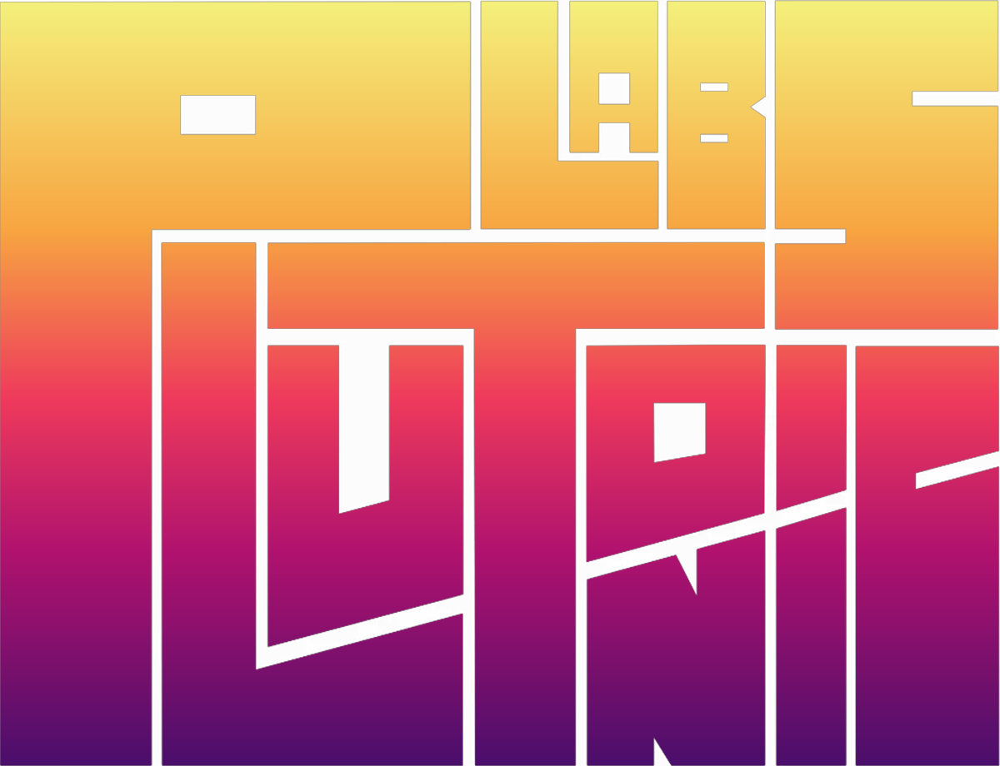
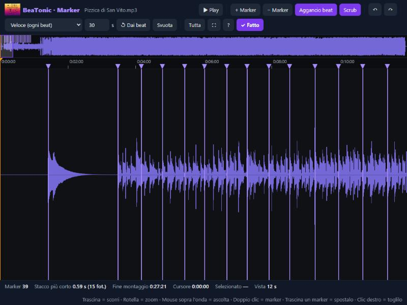

  

<h1 align="center">BeaTonic</h1>

<em>Montaggio a tempo di musica in DaVinci Resolve: le shot cadono sui beat.</em>

  
  
  
  

---

## Cos'è

**BeaTonic** crea un **montaggio ritmato a tempo di musica**. Gli dai delle clip
video e una canzone: lui analizza i **cambi di scena** nelle clip (le spezza in
singole "shot") e i **beat** del brano, poi monta le shot tagliandole **sui beat**.
Il risultato è una timeline già a ritmo — il tipo di stacco-su-stacco che a mano
richiede ore.

Il taglio segue l'energia della canzone: dove il brano spinge, gli stacchi si
infittiscono; dove si calma o sfuma, rallentano. Scegli lo **stile**
(veloce / medio / lento / **dinamico**, che segue da solo i sali-e-scendi del
pezzo), la **durata** in secondi e il **formato** (orizzontale 16:9 o verticale 9:16
per i social).

---

## Due temi

Col pulsante in alto a destra passi tra **Scuro — Plutonic Studio** (viola) e
**Chiaro — Plutonic Labs** (paper + gradiente tramonto). La scelta è ricordata e
condivisa con PlutoniCut.

---

## Requisiti

- **DaVinci Resolve Studio** (lo scripting non è disponibile nella versione gratuita).
- **ffmpeg** — rilevato in automatico se è in `D:\ffmpeg\bin` o `C:\ffmpeg\bin`;
  altrimenti imposta la variabile d'ambiente `FFMPEG` col percorso di `ffmpeg.exe`.
  → Scarica da **https://www.gyan.dev/ffmpeg/builds/** (build "release essentials").
- **Nessuna** dipendenza Python: usa solo la libreria standard.

---

## Installazione (il pannello dentro Resolve)

1. **Scarica** questo repository: **Code ▸ Download ZIP**, poi estrai.
2. Apri la cartella **degli script Utility** di Resolve:
   - **Windows:** `%APPDATA%\Blackmagic Design\DaVinci Resolve\Support\Fusion\Scripts\Utility`
   - **macOS:** `~/Library/Application Support/Blackmagic Design/DaVinci Resolve/Fusion/Scripts/Utility`

   *(Se la cartella `Utility` non c'è, creala.)*
3. **Copia dentro quella cartella** due file presi da `resolve_scripts/`:
   - `BeaTonic.py`
   - `plutonic_logo.png`  ← serve per mostrare il logo nel pannello.
4. Assicurati che **ffmpeg** sia installato (vedi Requisiti).
5. **Avvia (o riavvia) DaVinci Resolve.**
6. Trovi il plugin in **Workspace ▸ Scripts ▸ Utility ▸ BeaTonic**.

---

## Come si usa

1. Nel **Media Pool** seleziona le **clip video** (le sorgenti) **+ la canzone**
   (una clip audio).
2. **Aggiorna selezione** → controlla che veda N clip + la canzone.
3. **Analizza**: ffmpeg trova i cambi di scena e i beat.
   *(È l'operazione lenta: la finestra resta ferma mentre lavora.)*
   - Le clip vengono divise sia agli **stacchi** veri sia ai **cambi d'inquadratura**
     dentro una ripresa continua (la camera si sposta su un altro soggetto).
   - **Sensibilità scene**: *Media* è la consigliata; *Alta* trova più divisioni;
     *Bassa* tiene solo gli stacchi e i cambi più netti.
   - **Non dividere (clip intere)**: ogni video resta un pezzo unico.
4. Scegli **stile**, **formato**, **durata** e l'**ordine** delle clip:

   | Ordine | Cosa fa |
   |---|---|
   | **Nome A→Z** / **Z→A** | segue il nome dei file; le shot dello stesso video restano in ordine di tempo |
   | **Selezione** | l'ordine in cui hai selezionato le clip nel Media Pool |
   | **Casuale** | mischia le shot di **tutti** i video |

   La spunta **riusa clip** decide cosa fare quando il materiale finisce prima
   della durata scelta: acceso = ricomincia un nuovo giro, spento = si ferma lì.
5. **◆ Marker** *(facoltativo, consigliato)* → si apre l'**editor dei marker** in una
   finestra a parte (Chrome o Edge in modalità app, ridimensionabile e a schermo intero):
   la canzone con la forma d'onda come in una timeline, **un solo tipo di marker — ogni
   marker è un cambio clip** — partendo dai punti di taglio dello stile scelto.

   | Mouse | |
   |---|---|
   | trascina sull'onda | scorre la timeline (fluida) |
   | rotella | zoom attorno al mouse (`Shift` + rotella = scorre) |
   | passa sopra l'onda | **scrub**: senti l'audio in quel punto |
   | clic / doppio clic | sposta il cursore / nuovo marker |
   | trascina un marker | lo sposti (si aggancia ai beat, `Alt` = libero) |
   | clic destro su un marker | lo togli |
   | striscia in alto | tutta la canzone: clic o trascina per andarci |

   | Tastiera | |
   |---|---|
   | `Spazio` | play / pausa (la vista segue il cursore) |
   | `M` | marker sul cursore, anche mentre suona: battilo a tempo |
   | `Canc` | togli il marker selezionato |
   | `←` `→` | sposta il marker selezionato di 1 fotogramma (`Shift`: 10) |
   | `↑` `↓` | marker precedente / successivo |
   | `+` `−` `0` | zoom avanti / indietro / tutta la canzone |
   | `Ctrl+Z` `Ctrl+Shift+Z` | annulla / ripeti |
   | `S` `N` `F` | scrub · aggancio ai beat · schermo intero |

   Dall'editor puoi anche rifare i marker dai beat con un altro stile o un'altra durata.
   **Si salva da solo**: quando hai finito premi **✓ Fatto** e torna su Resolve.
   L'ultimo marker è la **fine** del montaggio.

   
6. **▶ Monta** → nasce la timeline montata: la canzone su A1 e **una clip tra un marker
   e l'altro**, esattamente sui fotogrammi dei marker. Se hai saltato il punto 5,
   taglia direttamente sui beat dello stile scelto. Nel log trovi il **riepilogo**:
   quanto materiale c'è e se è stato necessario ripetere qualche pezzo (e perché).

> Puoi riaprire l'editor, ritoccare i marker e premere **Monta** quante volte vuoi:
> ogni volta nasce una timeline nuova. Una nuova **Analizza** riparte da zero.
>
> L'editor gira solo sul tuo computer (un piccolo server locale su `127.0.0.1`, che si
> spegne quando chiudi BeaTonic): nessuna connessione esterna.

**Varietà:** a ogni stacco arriva una clip diversa (mai la stessa due volte di fila);
ogni volta che una clip ritorna ne mostra un pezzo nuovo, e un pezzo già visto si
ripete solo dopo aver usato **tutto** il materiale.

| Stile | Taglio |
|---|---|
| **Veloce** | uno stacco a ogni beat |
| **Medio** | uno stacco ogni mezza battuta (sull'1 e sul 3) |
| **Lento** | uno stacco a ogni battuta (sull'1) |
| **Dinamico** | battuta per battuta segue l'energia: a ogni beat dove il pezzo spinge, a ogni battuta dove è calmo |

Nessuno stacco è mai più corto di **0,33 s**: anche su un brano frenetico niente
tagli ogni due fotogrammi.

---

## Note tecniche

- Resolve non espone scene-cut né beat detection allo scripting: li fa **ffmpeg + DSP
  in Python** dentro al plugin.
- **Come ascolta la canzone**: non taglia su ogni colpo (charleston e rullate
  darebbero tagli ogni pochi fotogrammi) ma ricostruisce il **beat** come un musicista:
  1. trova il **tempo** (BPM) per autocorrelazione dei colpi, preferendo il beat che
     si sente (90–150 BPM: su una drum&bass a 174 prende il mezzo tempo);
  2. segue il beat con un **beat tracker a programmazione dinamica** (Ellis 2007, lo
     stesso metodo di librosa), che regge piccoli cambi di tempo;
  3. trova le **battute** (il "1") dalla cassa, sulla banda dei bassi;
  4. **gate sul silenzio**: dove il brano tace o sfuma non mette beat.

  Su brani di prova (128 BPM frenetico, drum&bass 174, accelerazione 110→130) i beat
  cadono entro 13 ms da quelli veri: meno di un terzo di fotogramma.
- Il montaggio parte da 0 insieme alla canzone (un'intro senza beat viene coperta da
  clip intere divise in parti uguali) e chiude sull'inizio di una battuta.
- **Stacchi al fotogramma**: dopo ogni clip il plugin legge dove è finita davvero in
  timeline e calcola la successiva per arrivare esattamente al marker dopo, quindi
  nessuno slittamento che si accumula. Con clip allo stesso fps della timeline o più
  alto gli stacchi sono esatti; con clip a fps più basso (es. 23,976 in timeline 25)
  qualche stacco può cadere a 1 fotogramma dal marker, mai di più.
- **Stacchi (metodo adattivo)**, come l'AdaptiveDetector di PySceneDetect: conta
  quanto un fotogramma *spicca* rispetto ai vicini, non una soglia fissa. Così una
  panoramica o un movimento veloce non tagliano, e uno stacco tra due inquadrature
  simili sì. I **flash** vengono scartati: dopo uno stacco vero l'immagine resta
  diversa, dopo un flash torna com'era.
- **Cambi d'inquadratura**: confronta l'immagine media del secondo prima con quella
  del secondo dopo (mani e persone in movimento si smussano, l'esposizione non conta)
  e divide solo dove il cambio spicca sul movimento tipico di quella clip; ogni pezzo
  dura almeno 3 s.
- Dà il meglio sui brani ritmici in 4/4; su pezzi senza percussioni (piano, ambient)
  il beat è più incerto.
- Il verticale da sorgenti orizzontali ritaglia/adatta secondo le impostazioni di conforma.

---

## Licenza

Software proprietario — © Matteo Congedo / Plutonic Studio. Tutti i diritti riservati.
Vedi [LICENSE](LICENSE).
